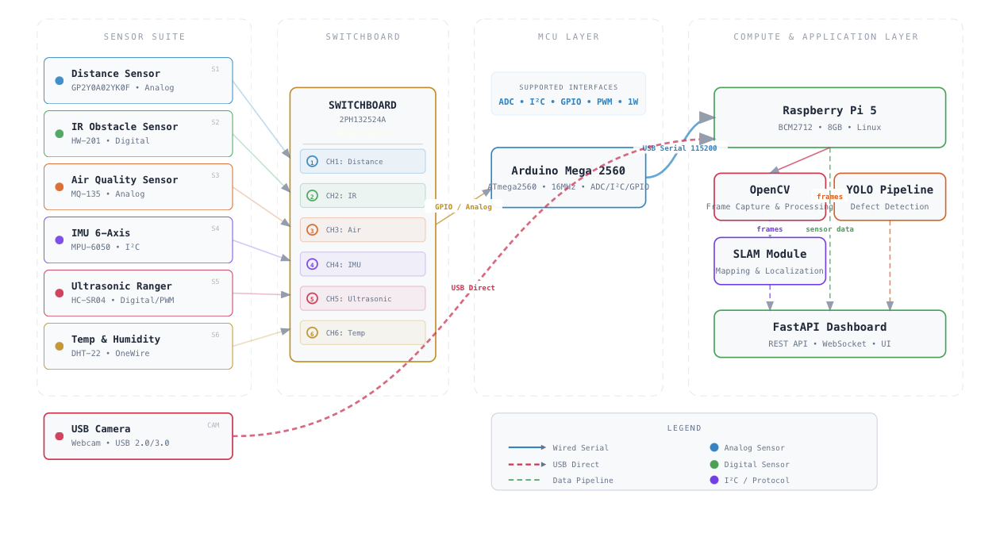
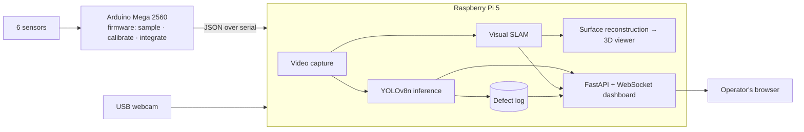
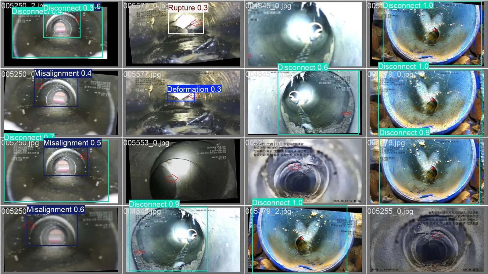
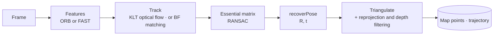

# AddamNet: architecture

> [!NOTE]
> This architecture write-up was added by
> [Claude Opus 5.5](https://docs.anthropic.com/en/docs/claude-code) in Nov 2026 using my
> [agentic-repo-analysis](https://github.com/sp4ce-cowboy/agentic-workflows) skill, from the
> project's code, git history and documentation.

A technical write-up of AddamNet, my B.Eng. dissertation (NUS ME4101A, AY2025/26, supervised by
[Prof. Chew Chee Meng](https://cde.nus.edu.sg/me/staff/chew-chee-meng-2/) ([Google Scholar](https://scholar.google.com/citations?user=woLCMSYAAAAJ)), graded A), from the code and the
[59-page dissertation](docs/dissertation/AddamNet-dissertation.pdf). Back to the [README](README.md).

**Contents:**
1. [Requirements and constraints](#1-requirements-and-constraints)
2. [System architecture](#2-system-architecture)
3. [Embedded sensing](#3-embedded-sensing)
4. [Defect detection (YOLOv8)](#4-defect-detection-yolov8)
5. [Monocular visual SLAM](#5-monocular-visual-slam)
6. [Surface reconstruction and the 3D viewer](#6-surface-reconstruction-and-the-3d-viewer)
7. [The dashboard](#7-the-dashboard)
8. [Decisions and trade-offs](#8-decisions-and-trade-offs)
9. [Evaluation and limitations](#9-evaluation-and-limitations)
10. [Future work](#10-future-work)

## 1. Requirements and constraints

- **The setting:** PWCS pipes under public housing estates. Refuse moves through buried steel
  pipes by high-speed air suction. The pipes last about 30 years, and inspecting them means
  sending workers into confined spaces. The wider programme aims for 45 years through early,
  automated defect detection.
- **This project's scope:** the robot's sensing and intelligence. That covers environmental
  and proximity sensing, localisation, defect detection, mapping of the pipe interior, and an
  operator view.
- **Constraints:**
  - Low-cost hardware.
  - **No internet** underground, so everything runs on the robot.
  - **No dedicated AI accelerator** in this version.
  - A small platform that a tether can pull through a pipe.

## 2. System architecture

A **two-tier design**:

| Tier | Hardware | Responsibility |
|---|---|---|
| Microcontroller | Arduino Mega 2560 | Real-time sensor sampling, IMU calibration and integration, JSON packets over USB serial (115,200 baud) |
| Compute | Raspberry Pi 5 (8 GB, Linux) | Camera capture, YOLO inference, SLAM, defect logging, the web dashboard |

The Mega was chosen over an Uno because the firmware, the I²C IMU routines and the six sensors'
pins exceeded the Uno's memory and I/O.

## 3. Embedded sensing

| Sensor | Measures | Role |
|---|---|---|
| MPU-6050 (I²C, 400 kHz) | Acceleration and rotation (±2 g, ±250 °/s) | Orientation and localisation |
| HC-SR04 ultrasonic | Distance | Forward ranging |
| Sharp GP2Y0A02YK0F infrared | Distance | Forward ranging, a second physical principle |
| HW-201 infrared | Obstacle present | Collision warning |
| MQ-135 | Gas, as raw ADC plus a quality band | Air quality and safety |
| DHT-22 | Temperature and humidity | Environment |

- **Calibration** ([`mpuCalibrate`](https://github.com/sp4ce-cowboy/AddamNet/blob/7c47efae85a2158621a294750ad775ef63fd990b/arduino/sensor_suite.ino#L256-L305)):
  - At start-up, the IMU averages 500 readings while still, to get per-axis gyroscope and
    accelerometer bias.
  - Testing found a −3.4 °/s gyroscope bias on one axis. Uncorrected, that is over 200° of
    orientation error a minute. After calibration, residual drift was under 0.5 °/s.
- **Integration:** from the bias-corrected IMU, the firmware integrates velocity, position,
  roll, pitch and yaw, plus total distance.
- **Sensor fusion:** ultrasonic and infrared distances are averaged, so one bad reading doesn't
  dominate.
- **Controls:** a 4×4 keypad toggles each sensor and a master switch, and there is a tether
  limit flag.
- **Output:** one JSON packet per sample, with readings, calibration status, enabled flags and
  run time. The report specifies 10 Hz; the committed sketch samples every 1,000 ms.

## 4. Defect detection (YOLOv8)

- **Model choice:** YOLOv8n, the smallest YOLOv8. It was chosen for CPU-only latency on the
  Pi, trading some accuracy for speed and deployability.
- **Data:** the [Pipeline Defect Dataset](https://www.kaggle.com/datasets/simplexitypipeline/pipeline-defect-dataset) by simplexity-Pipeline on Kaggle
  ([CC BY-NC-SA 4.0](https://creativecommons.org/licenses/by-nc-sa/4.0/)), frames from robot
  inspection videos. 22,120 images (17,639 for training, 4,481 for validation) in YOLO format,
  with 22,279 bounding boxes in the training set, across six classes: deformation, obstacle,
  rupture, disconnect, misalignment and deposition. The classes are moderately imbalanced:
  obstacle has 5,912 boxes, disconnect 1,948.
- **Training:** transfer learning from COCO-pretrained weights with the Ultralytics CLI
  (`yolo detect train model=yolov8n.pt epochs=1 batch=32 imgsz=480 device=mps`).

Validation predictions on frames from the Pipeline Defect Dataset (CC BY-NC-SA 4.0).

- **Runtime:** inference at 320 px with a 0.35 confidence threshold, at 2–5 fps on the Pi.
  Detections are logged with the sensor readings of that moment, and a per-class cooldown keeps
  repeated detections from flooding the log.

## 5. Monocular visual SLAM

My own pipeline in [`slam/visual_slam.py`](https://github.com/sp4ce-cowboy/AddamNet/blob/7c47efae85a2158621a294750ad775ef63fd990b/slam/visual_slam.py),
following the pySLAM framework's approach:

- **Camera model:** intrinsics come from the frame size and the field of view (`make_camera_matrix`).
- **Tracking:** pyramidal Lucas–Kanade optical flow follows features from frame to frame, with
  ORB descriptor matching as the alternative mode.
- **Pose:** an essential matrix with RANSAC, then `recoverPose` for rotation and
  translation direction.
- **Mapping:** `triangulatePoints` between frames. Points with bad reprojection or impossible
  depth are rejected (`filter_triangulated`).
- **Visualisation:** a live trajectory (top-down) and map-point overlay (`SLAMVisualizer`),
  as in the dashboard's Live Feed tab.
- **Limits:** monocular SLAM has no metric scale, and there is no loop closure. Both are
  addressed under future work.

## 6. Surface reconstruction and the 3D viewer

[`slam/reconstruct_viewer.py`](https://github.com/sp4ce-cowboy/AddamNet/blob/7c47efae85a2158621a294750ad775ef63fd990b/slam/reconstruct_viewer.py)
turns the SLAM output (a `.ply` point cloud and a trajectory CSV) into a mesh and a standalone
viewer:

1. Statistical outlier removal (k-nearest neighbours via `KDTree`).
2. Normal estimation from local neighbourhoods.
3. Surface by alpha shapes over a Delaunay triangulation. A k-NN mesh is added when the alpha
   shape is too sparse, and triangles with inconsistent normals are dropped.
4. Export as a single HTML file with Three.js: toggles for point cloud, mesh, wireframe,
   trajectory and axes; point size; opacity; colour modes; preset views and PNG export.

The result for the sample pipe run has 2,334 points, 24,025 faces and 254 camera poses,
[live on GitHub Pages](https://sp4ce-cowboy.github.io/AddamNet/slam-viewer/).

## 7. The dashboard

The dashboard in `app/` brings the SLAM code, the viewer generator, the Arduino stream and the
trained weights together in one application on the Pi.

- **Back end:** FastAPI. A lifespan starts background services for serial sensors (with a
  simulated fallback), video capture (webcam or file), YOLO inference, SQLite defect logging
  with cooldown, and live and batch SLAM. It exposes REST endpoints and a WebSocket
  (`/ws/live`) that pushes frames and telemetry.
- **Front end:** five tabs.
  - Live Feed: detection and SLAM side by side.
  - Sensors: the telemetry cards.
  - Defects: a linear schematic along the distance travelled, plus the log.
  - SLAM: run SLAM on a video, export, and the embedded 3D viewer.
  - System: services and latency.
- **Configuration:** one `config.yaml` covers the video source, model, serial port, cooldown,
  SLAM and server.
- **Online demo** ([`docs/demo`](docs/demo), live on GitHub Pages): the dashboard's own HTML, CSS
  and JavaScript, with a small shim standing in for the server. It replays a recorded run of the
  real dashboard: the 7-epoch model's detections on dataset frames, live SLAM on the sample clip,
  and simulated sensors.

## 8. Decisions and trade-offs

| Decision | Alternatives | Why | Cost |
|---|---|---|---|
| Two tiers: Arduino plus Pi | Pi only, with GPIO sensors | Deterministic sampling and analogue inputs on the MCU; the Pi stays free for vision | A serial protocol to maintain |
| Arduino Mega | Uno | Memory and pins for six sensors plus IMU maths | Larger board |
| YOLOv8n on the CPU | Larger YOLO; cloud inference | Fits offline, low-cost hardware | Lower accuracy than larger models |
| Monocular camera | Stereo or RGB-D | Cheap, simple, works with the existing webcam | No metric scale; weak initialisation |
| Own SLAM pipeline on OpenCV primitives | Full ORB-SLAM3 | Understandable, light enough for the Pi, easy to visualise | No loop closure or bundle adjustment |
| Standalone HTML viewer | A desktop viewer | Opens in any browser on the operator's machine | Large file with an embedded point cloud |

## 9. Evaluation and limitations

- **End to end:** confirmed working on the target hardware. Sensing, detection, SLAM and the
  dashboard run together offline.
- **IMU:** drift went from −3.4 °/s bias to under 0.5 °/s residual after calibration.
- **Detection:** the dissertation reports a **single-epoch baseline**: precision 0.267, recall
  0.253, mAP@0.5 0.242, mAP@0.5:0.95 0.081. A follow-up run (batch 16, 480 px) reached, after 7
  epochs, precision 0.507, recall 0.443, mAP@0.5 0.447 and mAP@0.5:0.95 0.256, still rising each
  epoch (`weights/best_7epoch.pt`). It needs longer training still before it is reliable.
- **SLAM:** scale-ambiguous, with no loop closure. Low texture and reflections inside steel
  pipes make tracking hard.
- **Throughput:** 2–5 fps of inference on the Pi's CPU.

## 10. Future work

- Train much longer and tune the model, then re-evaluate per class.
- An **RGB-D camera** (Intel RealSense D405): metric scale, PnP pose against known 3D points
  (as ORB-SLAM3 does in RGB-D mode), and dense TSDF or surfel reconstruction of the pipe wall.
- An **AI accelerator** (Hailo-8 or Jetson) for higher frame rates with larger models.
- **Defects on the map:** attach each detection to its SLAM pose, building a semantically
  labelled 3D defect map of the pipe network.
