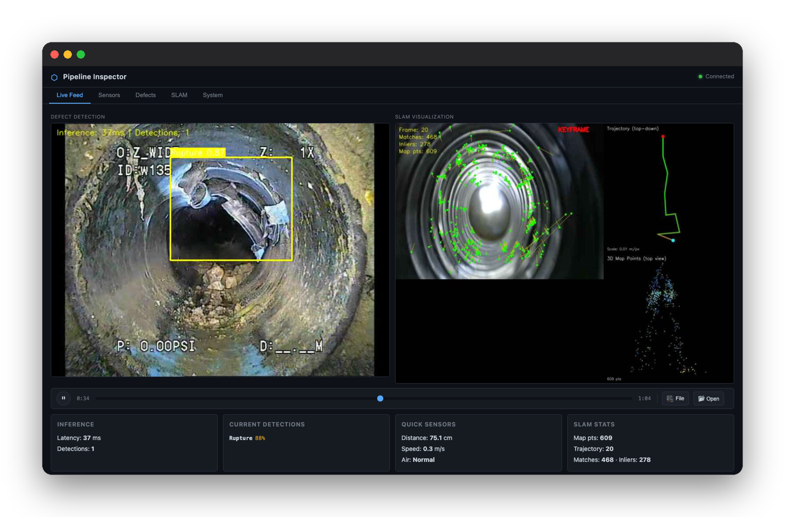
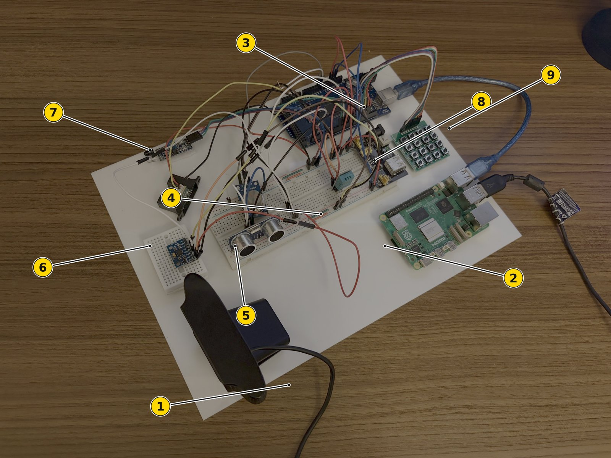
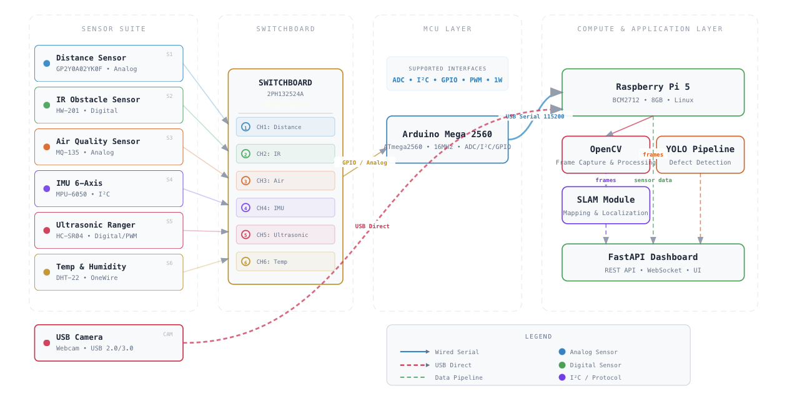
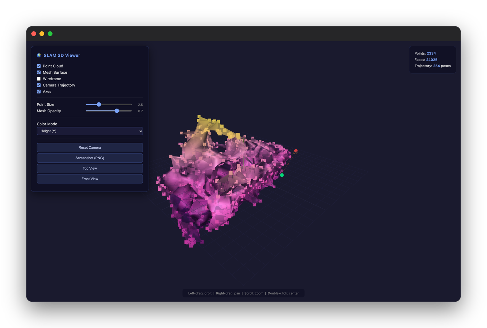
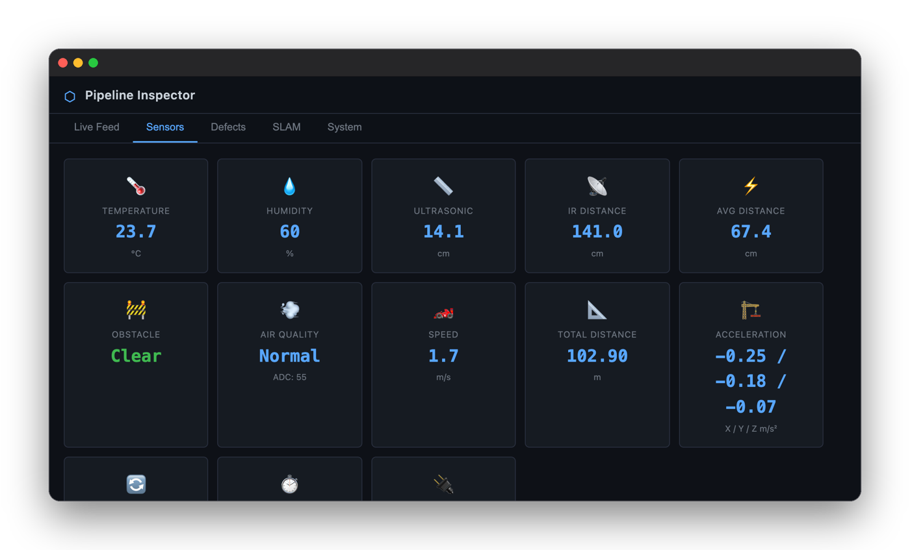
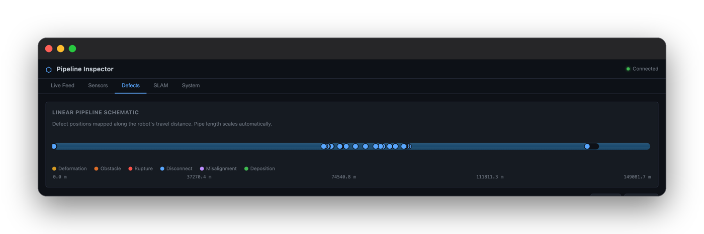

# AddamNet

**Autonomous defect detection and 3D mapping inside underground waste pipes.** 
The sensing and intelligence stack for an unmanned robot that inspects the pipes of the
[Pneumatic Waste Conveyance System](https://www.mnd.gov.sg/newsroom/parliament-matters/q-as/view/written-answer-by-ministry-of-national-development-on-hdb-estates-with-pneumatic-waste-conveyance-system-and-cost-benefit-analysis-of-these-systems) (PWCS) in Singapore's HDB estates: embedded sensing,
YOLOv8 defect detection, monocular visual SLAM and a live dashboard, all on a Raspberry Pi 5.

*A Bachelor of Engineering Dissertation (Final Year Project), Department of Mechanical Engineering,
College of Design and Engineering, National University of Singapore, submitted in partial
fulfilment of the requirements for the Degree of Bachelor of Engineering, as part of my
specialisation in Robotics. Session 2025/2026.*

**[▶ Try the dashboard (live demo)](https://sp4ce-cowboy.github.io/AddamNet/demo/)** ·
**[3D reconstruction viewer](https://sp4ce-cowboy.github.io/AddamNet/slam-viewer/)**

> [!NOTE]
> This consolidated README page was added by
> [Claude Opus 5.5](https://docs.anthropic.com/en/docs/claude-code) in Nov 2026 using my
> [agentic-repo-analysis](https://github.com/sp4ce-cowboy/agentic-workflows) skill, from the
> project's code, git history and my dissertation. The project itself is from Aug 2025 – Apr 2026.
> The original README, the dashboard's set-up guide, is in
> **[README-ORIGINAL.md](README-ORIGINAL.md)**. The technical write-up is in
> **[ARCHITECTURE.md](ARCHITECTURE.md)**.

  

The <a href="https://sp4ce-cowboy.github.io/AddamNet/demo/">live demo</a>: the 7-epoch model on a dataset frame, beside live SLAM on the sample clip

## At a glance

| | |
|---|---|
| **What** | The sensing and intelligence stack for an unmanned PWCS pipe-inspection robot: a six-sensor embedded system, AI defect detection, 3D mapping of the pipe interior, and a live dashboard, running on low-cost hardware with no internet |
| **Context** | NUS ME4101A Bachelor of Engineering Dissertation (Final Year Project), Department of Mechanical Engineering, AY2025/26, supervised by Prof. Chew Chee Meng. Graded A |
| **My role** | Individual project: requirements, hardware, Arduino firmware, training the model on a public dataset, the SLAM and 3D-reconstruction pipeline, system integration, and the 59-page report |
| **Dataset** | The [Pipeline Defect Dataset](https://www.kaggle.com/datasets/simplexitypipeline/pipeline-defect-dataset) by simplexity-Pipeline on Kaggle ([CC BY-NC-SA 4.0](https://creativecommons.org/licenses/by-nc-sa/4.0/)): 22,120 images (17,639 for training, 4,481 for validation) across six defect classes |
| **Domains** | Embedded systems · computer vision · machine learning · robotics (SLAM) · web |
| **AI use** | As acknowledged in the dissertation, the dashboard prototype (`app/`) was generated with Claude Opus 4.6; the firmware, model, SLAM and reconstruction code are mine |

## The problem

Singapore's Housing & Development Board (HDB) builds the [Pneumatic Waste Conveyance System](https://www.mnd.gov.sg/newsroom/parliament-matters/q-as/view/written-answer-by-ministry-of-national-development-on-hdb-estates-with-pneumatic-waste-conveyance-system-and-cost-benefit-analysis-of-these-systems)
into its newer public housing estates: refuse moves from each block through buried steel pipes to a
central bin centre, by high-speed air suction. The pipes last about 30 years before costly
replacement, and inspecting them today means workers entering confined spaces, after something has
already gone wrong. This project is part of a wider HDB initiative to extend pipe life from 30 to 45
years by finding defects early, with a robot instead of a person.

## What it does

  
  

The embedded system as built (1 webcam · 2 Raspberry Pi 5 · 3 Arduino Mega 2560 · 4 breadboard · 5 ultrasonic · 6 IMU · 7 IR obstacle · 8 temperature/humidity · 9 keypad) and its architecture

- **Senses the pipe.** An Arduino Mega reads six sensors: an IMU, ultrasonic and infrared distance,
  an IR obstacle sensor, gas (air quality), and temperature and humidity. It streams JSON packets to
  the Pi, including orientation, speed, distance travelled and a tether warning.
- **Finds defects.** A YOLOv8n model, trained on 22,120 labelled images from the
  [Pipeline Defect Dataset](https://www.kaggle.com/datasets/simplexitypipeline/pipeline-defect-dataset), detects six defect classes (deformation, obstacle, rupture,
  disconnect, misalignment, deposition) on the Pi's CPU.
- **Maps the pipe in 3D.** A monocular visual SLAM pipeline tracks the camera and builds a sparse 3D
  map. A reconstruction step turns the map into a surface mesh and an interactive 3D viewer.
- **Shows it all live.** A five-tab web dashboard shows the annotated video, telemetry, a defect log
  laid along the pipe, the 3D reconstruction, and system health.
  **[Try it in your browser](https://sp4ce-cowboy.github.io/AddamNet/demo/)**: a recorded run of the
  real dashboard, replayed with the 7-epoch model's detections on dataset frames, live SLAM on the
  sample clip, and simulated sensors.

  
  

  

The 3D viewer (2,334 points, 24,025 faces, 254 camera poses; <a href="https://sp4ce-cowboy.github.io/AddamNet/slam-viewer/">try it live</a>) · live telemetry · defects along the pipe. Dashboard captures from a sample pipe video, with the sensors simulated

## Skills shown

| Skill | Where it shows (click the links for the code) | Docs |
|---|---|---|
| **Embedded firmware**  | Six-sensor firmware with JSON output and per-sensor enable switches: [`sensor_suite.ino`](https://github.com/sp4ce-cowboy/AddamNet/blob/7c47efae85a2158621a294750ad775ef63fd990b/arduino/sensor_suite.ino); IMU bias calibration over 500 samples: [`mpuCalibrate`](https://github.com/sp4ce-cowboy/AddamNet/blob/7c47efae85a2158621a294750ad775ef63fd990b/arduino/sensor_suite.ino#L256-L305) | [Arduino](https://docs.arduino.cc) |
| **Visual SLAM**  | ORB/FAST features, KLT optical-flow tracking, RANSAC essential-matrix pose recovery: [`track_klt`, `estimate_pose`](https://github.com/sp4ce-cowboy/AddamNet/blob/7c47efae85a2158621a294750ad775ef63fd990b/slam/visual_slam.py#L175-L243); triangulation and reprojection filtering: [`triangulate_points`](https://github.com/sp4ce-cowboy/AddamNet/blob/7c47efae85a2158621a294750ad775ef63fd990b/slam/visual_slam.py#L86-L128) | [OpenCV calib3d](https://docs.opencv.org/4.x/d9/d0c/group__calib3d.html) |
| **3D surface reconstruction**  | Statistical outlier removal, normal estimation and alpha-shape meshing of the point cloud: [`reconstruct_viewer.py`](https://github.com/sp4ce-cowboy/AddamNet/blob/7c47efae85a2158621a294750ad775ef63fd990b/slam/reconstruct_viewer.py#L69-L195) | [scipy.spatial](https://docs.scipy.org/doc/scipy/reference/spatial.html) |
| **Object detection**  | Transfer learning from COCO weights on six defect classes; the trained model: [`weights/`](https://github.com/sp4ce-cowboy/AddamNet/tree/7c47efae85a2158621a294750ad775ef63fd990b/weights) | [Ultralytics](https://docs.ultralytics.com) |
| **Edge deployment**  | CPU-only inference at 2–5 fps with no internet or accelerator; serial link at 115,200 baud: [`config.yaml`](https://github.com/sp4ce-cowboy/AddamNet/blob/7c47efae85a2158621a294750ad775ef63fd990b/config.yaml) | [Raspberry Pi](https://www.raspberrypi.com/documentation/) |
| **Interactive 3D on the web**  | The generated viewer: point cloud, mesh, trajectory, colour modes: [live demo](https://sp4ce-cowboy.github.io/AddamNet/slam-viewer/) | [Three.js](https://threejs.org/docs/) |
| **System integration** | Firmware, model and SLAM wired into one FastAPI and WebSocket dashboard (the dashboard prototype generated with Claude): [`app/`](https://github.com/sp4ce-cowboy/AddamNet/tree/7c47efae85a2158621a294750ad775ef63fd990b/app) | [FastAPI](https://fastapi.tiangolo.com) |
| **Research & technical writing** | A 59-page dissertation: literature, design, evaluation, limitations and future work | — |

## Results

- **End to end on low-cost hardware.** Sensing, detection, mapping and the dashboard all run
  together on a Raspberry Pi 5, with no internet and no AI accelerator.
- **IMU calibration.** A start-up routine averaging 500 stationary readings removed a gyroscope bias
  of about −3.4 °/s on one axis, which would have caused over 200° of orientation error a minute.
  Residual drift came down to under 0.5 °/s.
- **Detection.** Runs at 2–5 fps on the Pi's CPU. The dissertation reports a single-epoch baseline
  (mAP@0.5 of 0.24). A follow-up run of 7 epochs reached mAP@0.5 of 0.45 (precision 0.51, recall
  0.44) and was still improving; its weights are in [`weights/best_7epoch.pt`](weights) and drive the
  online demo.
- **Mapping.** Produces a camera trajectory and a sparse 3D map of the pipe interior. Monocular SLAM
  is scale-ambiguous and has no loop closure yet.

**Next steps (from the dissertation):** longer training, an RGB-D camera (Intel RealSense D405) for
metric dense mapping, a Hailo-8 or Jetson accelerator, and placing each detection on the 3D map.

## On my resume

**Skills:** embedded C++ (Arduino) · sensor fusion and IMU calibration · Python · OpenCV · visual SLAM · 3D reconstruction (NumPy, SciPy) · object detection (YOLOv8, transfer learning) · edge deployment (Raspberry Pi) · Three.js · system integration · technical writing

- Designed and built the sensing and intelligence stack for an unmanned robot that inspects the pneumatic waste conveyance (PWCS) pipes of Singapore's HDB estates, as my Bachelor of Engineering dissertation in Mechanical Engineering at NUS (graded A): a two-tier Raspberry Pi 5 and Arduino Mega 2560 platform with six sensors, YOLOv8 defect detection, monocular visual SLAM and a live dashboard, running fully offline.
- Wrote the Arduino firmware for six sensors (MPU-6050 IMU over I²C, ultrasonic and infrared ranging, IR obstacle, MQ-135 gas, DHT-22 temperature and humidity), streaming JSON packets to the Pi over a 115,200-baud serial link, with per-sensor switches on a keypad and a tether-limit flag.
- Cut IMU gyroscope drift from a −3.4 °/s bias (over 200° of heading error a minute) to under 0.5 °/s with a 500-sample start-up calibration, and integrated the corrected readings into orientation, velocity and distance travelled.
- Implemented a monocular visual SLAM pipeline in Python and OpenCV: ORB/FAST features, pyramidal KLT optical-flow tracking, RANSAC essential-matrix pose recovery, and triangulation with reprojection and depth filtering, producing a camera trajectory and a sparse 3D map of the pipe interior.
- Built a surface-reconstruction step with NumPy and SciPy (k-NN statistical outlier removal, normal estimation, alpha-shape meshing over a Delaunay triangulation) that exports a self-contained Three.js viewer of the pipe: 2,334 points, 24,025 faces and 254 camera poses for the sample run.
- Trained a YOLOv8n detector by transfer learning from COCO weights on 22,120 labelled pipe images across six defect classes, chosen for CPU-only inference on the Raspberry Pi (2–5 fps); a follow-up 7-epoch run reached mAP@0.5 of 0.45, against the dissertation's 1-epoch baseline of 0.24.
- Integrated the firmware, detector and SLAM into a real-time FastAPI and WebSocket operator dashboard on the Pi that logs each defect to SQLite with the sensor readings of that moment, and documented the system in a 59-page dissertation.

## Getting started

See [README-ORIGINAL.md](README-ORIGINAL.md) for the full set-up on a Raspberry Pi 5. On a laptop, set
`video.source: "file"` in `config.yaml` with a sample video. Sensors fall back to simulated data
when no Arduino is connected. Then run `python3 run.py` and open `http://127.0.0.1:8000`.
